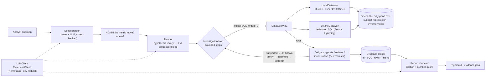

# CauseTrail

**An evidence-first root-cause agent for business metrics.**
Ask *"why did refunds spike in week 40 in APAC?"* and CauseTrail plans an investigation, runs federated SQL
across every source that matters, tries to **falsify** each explanation, and writes a report in which
**every sentence is bound to the exact query and rows that support it**.

> GenAI.Works Open Agent Hackathon 2026 · Track 02 — *The Agent That Can Explain Why*

## Who it is for

An operations / finance analyst at a small e-commerce company. A metric moved ("refund rate jumped last
week", "APAC margin fell"). The data that explains it is scattered across an orders database, an ad-spend
CSV, a helpdesk JSON export and a supplier spreadsheet. Today they spend hours hand-joining these and still
end up with a conclusion nobody can check.

## What makes it different

| A chatbot over your data | CauseTrail |
|---|---|
| Answers with one plausible story | Plans several hypotheses and **tries to kill each one** |
| Numbers you cannot trace | **Evidence ledger**: id, SQL, gateway, row sample, timestamp, finding |
| Any sentence can be printed | Renderer **refuses** a claim with no evidence id, or with a number its evidence doesn't contain |
| "Confident" by default | Explicit confidence with the reasons, and a *What I could not check* section |

## Quick start (offline, ~1 minute)

```bash
python3 -m venv .venv && . .venv/bin/activate
pip install -r requirements-dev.txt
python -m causetrail gen-data                       # seeded demo sources -> ./data
python -m causetrail ask "why did refunds spike in week 40 in APAC?" --llm none
pytest -q
```

`--llm none` runs fully deterministic (no model needed). With a model configured (see below) the same command
also uses the LLM to read the question, prioritise and propose extra hypotheses, judge ad-hoc queries and
write an executive summary — all of which pass through the same citation guard.

Outputs land in `out/`: `report.md` (the report), `evidence.json` (the full ledger), `trace.txt` (agent steps).

Other commands:

```bash
python -m causetrail schema                          # logical tables and which file/system they come from
python -m causetrail sql "SELECT region, COUNT(*) FROM {orders} GROUP BY 1"
python -m causetrail ask "..." --full                # include the evidence ledger in stdout
python -m causetrail llm-check --llm meterless       # verify the model endpoint
```

## The demo data (and the planted root cause)

`python -m causetrail gen-data --seed 7` writes 12 weeks (ISO W29–W40, 2026) of daily data for a fictional
gadget shop, deliberately fragmented:

| Source | Format | Contents |
|---|---|---|
| `orders.db` | SQLite | `orders`, `order_items`, `payments`, `refunds` (~10k orders) |
| `ad_spend.csv` | CSV | daily spend by market / channel / campaign |
| `support_tickets.json` | JSON export | helpdesk tickets; orders referenced as `"#100123"` strings |
| `inventory_supplier.xlsx` | Excel | sheets `skus`, `warehouses`, `suppliers`, weekly `lead_times` |

Planted cause: supplier **SUP-07** — the only Wearables supplier for the APAC warehouse — slips its lead time
from 7 to ~22 days from W36. APAC Wearables go on backorder, ship late, customers open "where is my order?"
tickets and some cancel. The refund table only says `customer_request`; the cause is visible **only** when
refunds are joined to order items (SQLite), SKU families and supplier lead times (Excel) and tickets (JSON).

Red herrings the agent must rule out: a new APAC paid-social campaign in W39–W40, background chargebacks and
damaged-item refunds, and flat payment failures.

## What a run looks like

```
Answer
- Most likely root cause: A supplier lead-time slip for Wearables at the APAC warehouse caused the late shipments. [E11] [E12]
- Supplier SUP-07 (Shenzhen Lumen Electronics) for Wearables at SIN-1 slipped to 22 days lead time vs 7 promised ... [E11]
- Wearables orders in APAC shipped late 46.4% of the time in the incident window ... vs 1.7% in the baseline ... [E08]
- In APAC, late orders were refunded 25.85% of the time vs 2.43% for on-time orders (10.6x, 147 late orders). [E09]
- 44.4% of APAC refunds in 2026-W40 were preceded by a shipping-delay support ticket ... vs 2.0% in the baseline. [E10]
Confidence: high (0.90)
Ruled out
- H1 paid-social campaign: paid_social refund rate 3.2% vs 4.9% for all other channels (ratio 0.67). [E04]
- H2 payment problems: failures 2.75 per 100 orders vs 3.46 baseline. [E05]
- H3 product quality: quality reasons explain 4.7% of the excess refunds. [E06]
```

## Architecture



### Modules

| Module | Role |
|---|---|
| `causetrail/sources.py` | `DataGateway` interface (`run_sql`, `list_schema`); `LocalGateway` (DuckDB), `ZetarisGateway` (REST). Logical table names in braces, `DAYS_BETWEEN(a,b)` dialect macro |
| `causetrail/llm.py` | `LLMClient` interface; `MeterlessClient` (OpenAI-compatible, Nemotron default), dev fallback client, `NullLLM`, `ScriptedLLM` for tests |
| `causetrail/evidence.py` | Evidence ledger; `check_claim` refuses uncited claims, unknown ids and ungrounded numbers |
| `causetrail/hypotheses.py` | Hypothesis library: each probe is SQL + a deterministic falsification judge |
| `causetrail/agent.py` | The loop: scope → H0 → plan → test/drill down → confidence → limits |
| `causetrail/report.py` | Markdown report; every printed claim passes the guard |
| `causetrail/datagen.py` | Seeded synthetic data with the planted cause and red herrings |
| `causetrail/cli.py` | `python -m causetrail …` |

### Guard rails on the model

* Scope from the LLM is cross-checked against a rule parser; on conflict the explicit tokens win.
* LLM-proposed SQL must be a single read-only `SELECT`/`WITH`; anything else is refused and logged.
* LLM judgements of ad-hoc queries are discarded if they quote a number not present in the result rows,
  and LLM-judged refutations never raise confidence.
* LLM summary sentences that are uncited or contain an ungrounded number are refused and listed in an appendix.

## Configuration

All configuration is via environment variables (see `.env.example`); nothing secret lives in the repo.

| Variable | Purpose |
|---|---|
| `METERLESS_BASE_URL`, `METERLESS_RUNTIME_TOKEN`, `METERLESS_MODEL` | Meterless Runtime / Nightshift endpoint, runtime token, model (Nemotron by default) |
| `NVIDIA_API_KEY`, `NVIDIA_MODEL` | optional dev fallback straight to NVIDIA-hosted Nemotron (not the submission path) |
| `ZETARIS_REST_URL`, `ZETARIS_API_KEY`, `ZETARIS_ORG_ID`, `ZETARIS_TABLE_MAP` | Zetaris Lightning REST endpoint and logical→physical table map |
| `CC1500_BASE_URL`, `CC1500_API_KEY`, `CC1500_MODEL` | optional development fallback LLM (or `~/.secrets/cc1500.env`) |

`--llm auto` (default) picks Meterless if configured, then NVIDIA direct, then the dev fallback, then deterministic mode.

## Sponsor technology

> **Placeholder — to be completed during the build week.**

* **Zetaris (data layer).** _TODO:_ the four sources registered as Zetaris datasources; every agent query runs as
  one federated SQL statement through `ZetarisGateway`. Status: gateway implemented against the documented
  REST call shape, not yet run on a live instance. See `zetaris/README.md`.
* **Meterless (model execution) + NVIDIA Nemotron.** _TODO:_ `MeterlessClient` routes scope parsing, planning,
  ad-hoc judging and the executive summary to a Nemotron model via Nightshift. Status: client implemented
  (OpenAI-compatible, bearer auth, model discovery via `GET /v1/models`), not yet run against a live runtime.
* **Meterless Engine (build rule).** _TODO:_ the rules also require at least one Meterless *Engine*
  (H-MEM, Markovian, World Model or Scout Intent) implemented in working code with a passing conformance test.
  Candidate: Scout Intent as an injection guard on untrusted support-ticket text before it reaches the model.
* **Cursor.** Developed in Cursor.

## Tests

```bash
pytest -q
```

Covers: the ledger refuses uncited claims / unknown ids / invented numbers; every logical table and a
SQLite×JSON×Excel join run against generated data; reproducible generation; the loop terminates under any
step budget and with a garbage-emitting LLM; a deterministic end-to-end run with a scripted LLM reaches the
planted root cause (SUP-07 → Wearables → APAC) and rules out the red herrings; robustness across seeds.

## Provenance

All code in this repository was written during the hackathon build window (from 2026-10-22). The
`ZetarisGateway` REST call shape follows Zetaris' public *getting-started* scripts (Apache-2.0); no code
was copied verbatim. Dependencies: DuckDB, pandas, openpyxl (runtime), pytest (tests).

## License

MIT
